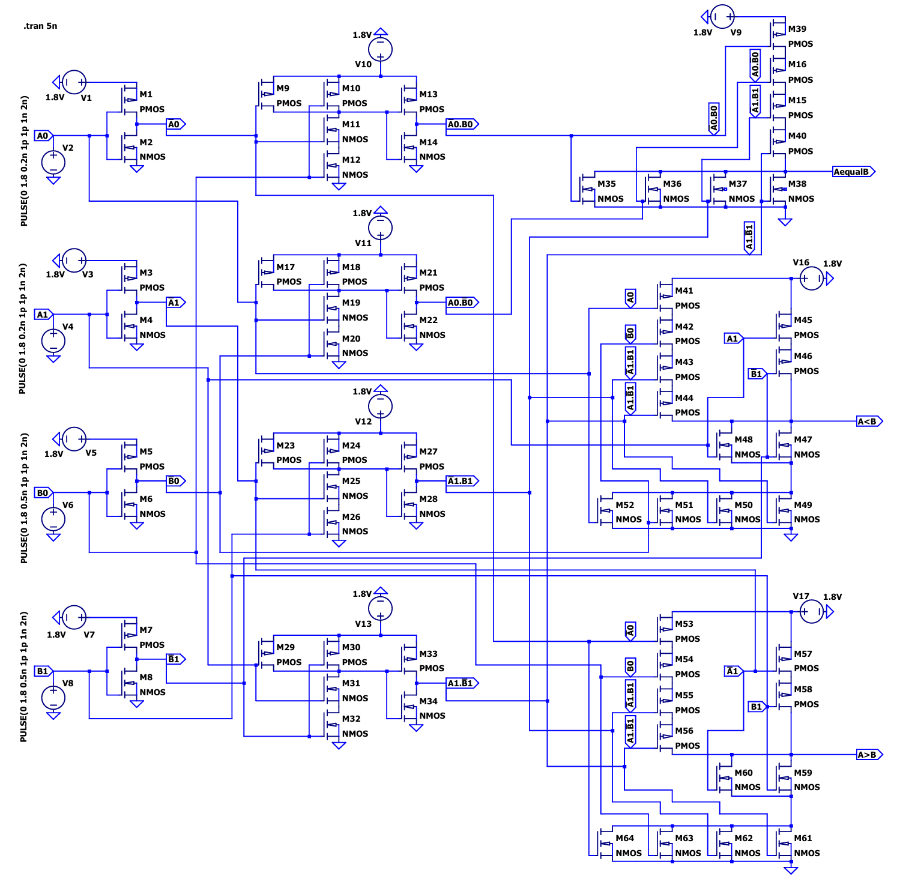
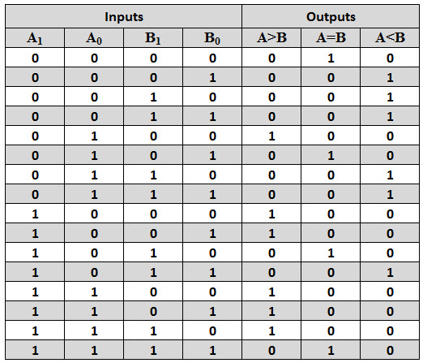
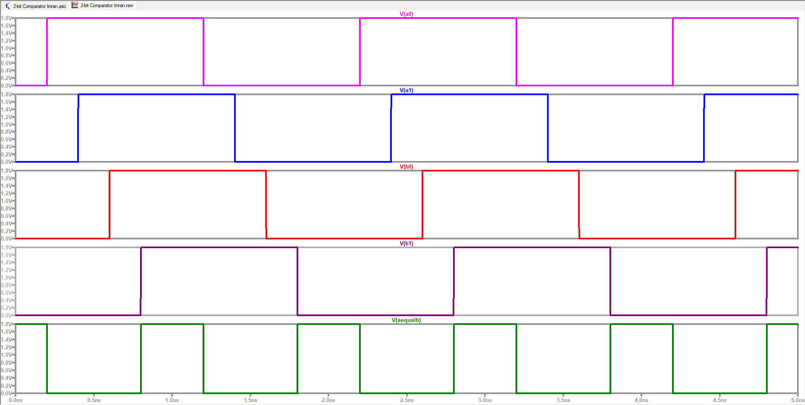
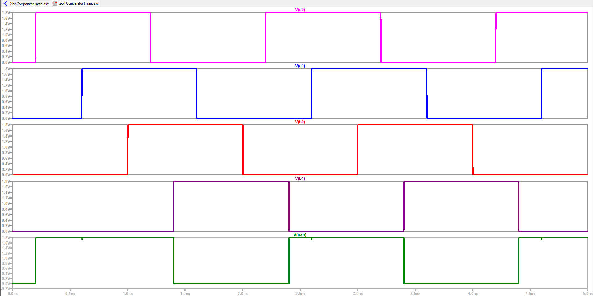
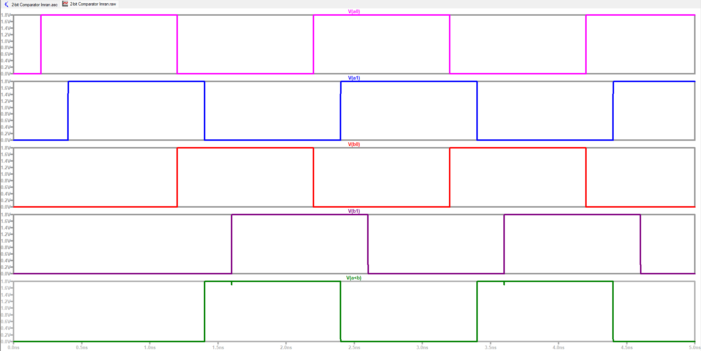

# 2-Bit Comparator IC Design

Transistor-level design and simulation of a **2-bit binary magnitude comparator** in **LTspice** using
**180 nm CMOS** models. It compares A (A1A0) with B (B1B0) and drives three one-hot outputs:
**A > B**, **A = B** and **A < B**.

Course project for **EEE-4754 VLSI I Sessional** (Dept. of EEE, IIUC, 7th semester, Spring 2026),
based on the *Complex Engineering Problem* brief in [`docs/brief/`](docs/brief/Complex-Engineering-Problem-SP26.pdf).



## Design at a glance

| Item | Value |
|---|---|
| Inputs | A1, A0, B1, B0 |
| Outputs | A > B, A = B, A < B (one-hot) |
| Logic families | Static CMOS + Complex CMOS |
| Transistor count | 64 (32 NMOS + 32 PMOS) |
| Device size | W = 400 nm, L = 180 nm (all transistors) |
| Supply | 1.8 V |
| Models | BSIM3v3 (Level 49) 180 nm NMOS/PMOS, defined inside the schematic |
| Simulator | LTspice 26 |
| Transient run | `.tran 5n` |

A dynamic-CMOS version was also attempted but did not produce the expected outputs, so the final
design uses static and complex CMOS only (see the report).

## Logic

With `A1 ⊙ B1` meaning XNOR:

```
A = B :  (A1 ⊙ B1) · (A0 ⊙ B0)
A > B :  A1·B1' + (A1 ⊙ B1)·A0·B0'
A < B :  A1'·B1 + (A1 ⊙ B1)·A0'·B0
```

The MSBs are compared first. The LSBs only decide the result when the MSBs are equal.
These expressions match the 16-row truth table in the report (checked programmatically).



## Simulation results

All 16 input combinations were checked in a transient run. Inputs are four `PULSE` sources
(0 → 1.8 V, 1 ns width, 2 ns period) with different start delays of 0.2, 0.4, 1.2 and 1.6 ns.

| A = B | A > B | A < B |
|---|---|---|
|  |  |  |

In each case only the matching output goes high.

## Repository layout

```
2bit-comparator-ic-design/
├── simulation/ltspice/
│   ├── 2-bit-comparator.asc        # final schematic + testbench (open in LTspice)
│   └── 2-bit-comparator.log        # simulation log
├── docs/
│   ├── Project-Report.pdf / .docx  # final report
│   ├── Cover-Page.pdf
│   ├── Schematic-Print.pdf
│   ├── brief/                      # assignment brief
│   └── images/                     # schematic, waveforms, truth table
├── earlier-design/                 # first iteration: schematic, report, Microwind layout
├── LICENSE
└── README.md
```

## Run the simulation

1. Install [LTspice](https://www.analog.com/en/resources/design-tools-and-calculators/ltspice-simulator.html).
2. Open `simulation/ltspice/2-bit-comparator.asc`.
3. Click **Run**. Plot the three output nodes (the `A>B`, `A=B` and `A<B` labels) and the four inputs.

Raw waveform files (`*.raw`) are not stored in the repo. They are regenerated when you run the simulation.

## Team

| Name | Contribution |
|---|---|
| Md. Abdullah Al Muntasir | Report writing, proofreading |
| Md. Minhaj Uddin Raiyyan | Report writing, proofreading |
| Imran Yakub | LTspice design, report writing |

## Earlier design iteration

[`earlier-design/`](earlier-design/) holds a first version: its LTspice schematic, its own report, and a
**Microwind** layout (`LayoutV1.MSK`). It is kept for reference and is not the final design.

## Notes and open items

- **Model ambiguity warning.** The log says the `NMOS`/`PMOS` models have multiple definitions and that
  LTspice "chose one" because `ALLOW_AMBIGUOUS_MODELS` is on. It also warns that some transistors are
  below the recommended size for a *Level 1* MOSFET. This suggests LTspice's built-in models may have
  been used instead of the Level 49 models in the schematic. Worth checking: rename the models in the
  schematic (for example `NMOS_180`, `PMOS_180`), update the transistor symbols to match, and re-run.
- **Propagation delay** is required by the brief but is not reported in the final report.
- **Transistor count in the earlier report.** The first-iteration report says 48 transistors, but its
  schematic file contains 64 (32 NMOS + 32 PMOS).

## License

MIT. Change it if your course or team requires otherwise.
